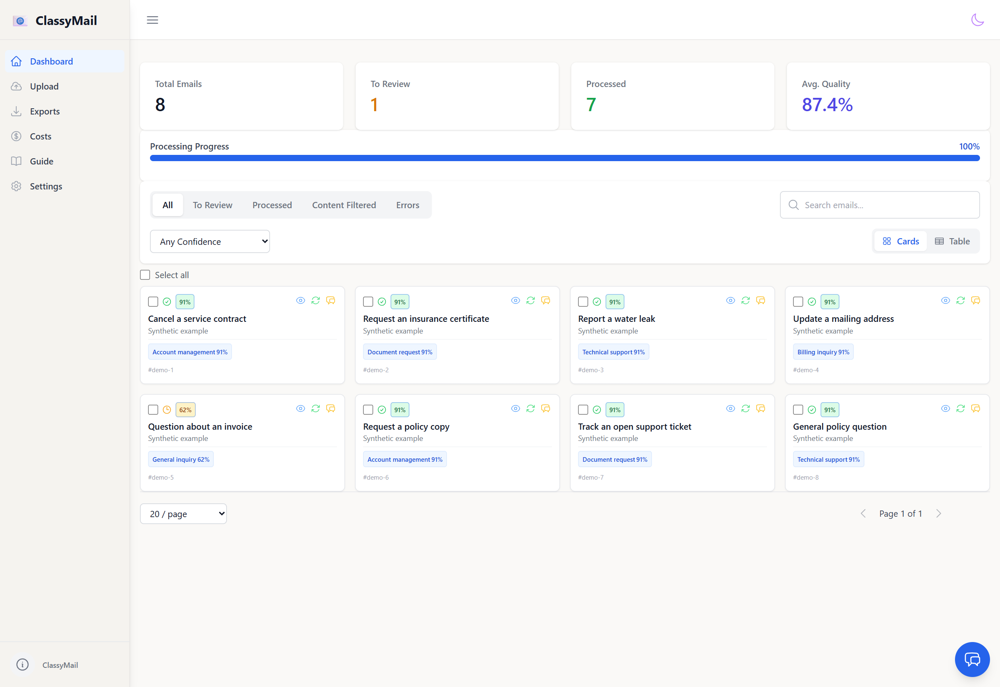
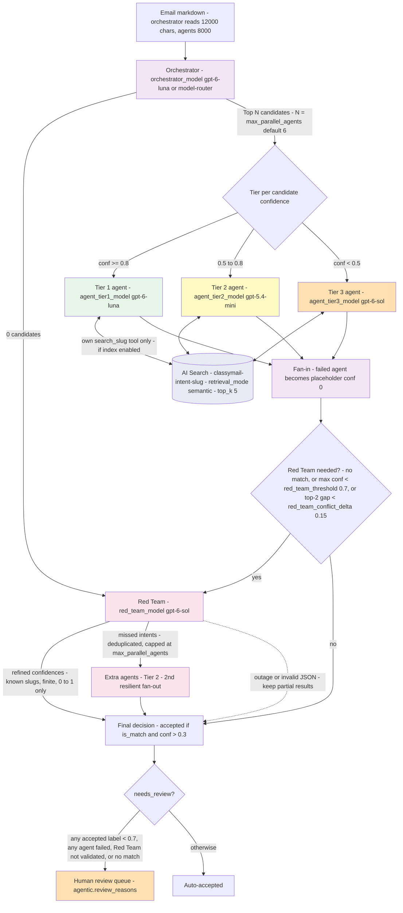
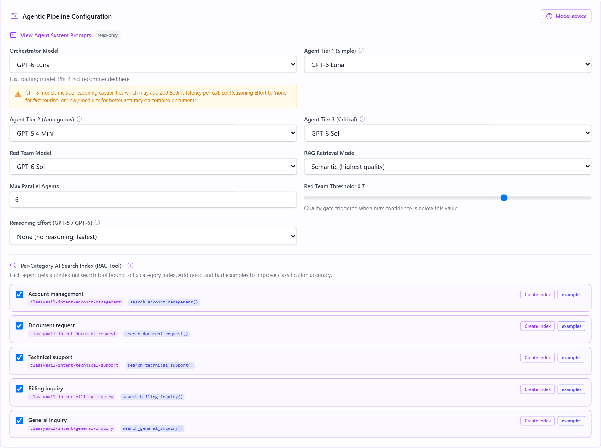
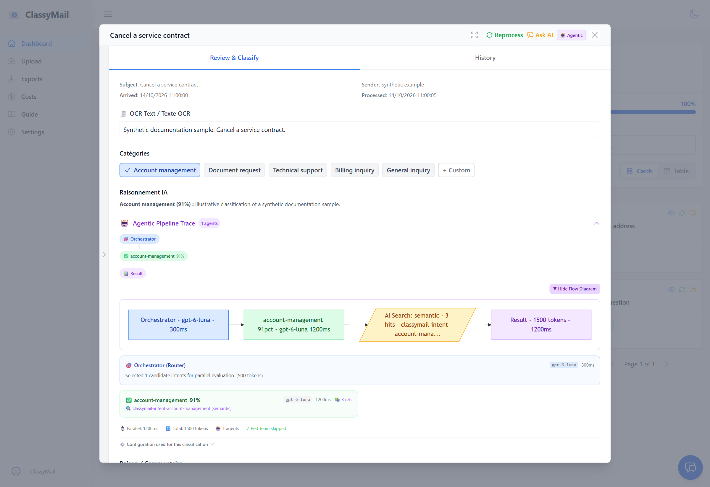
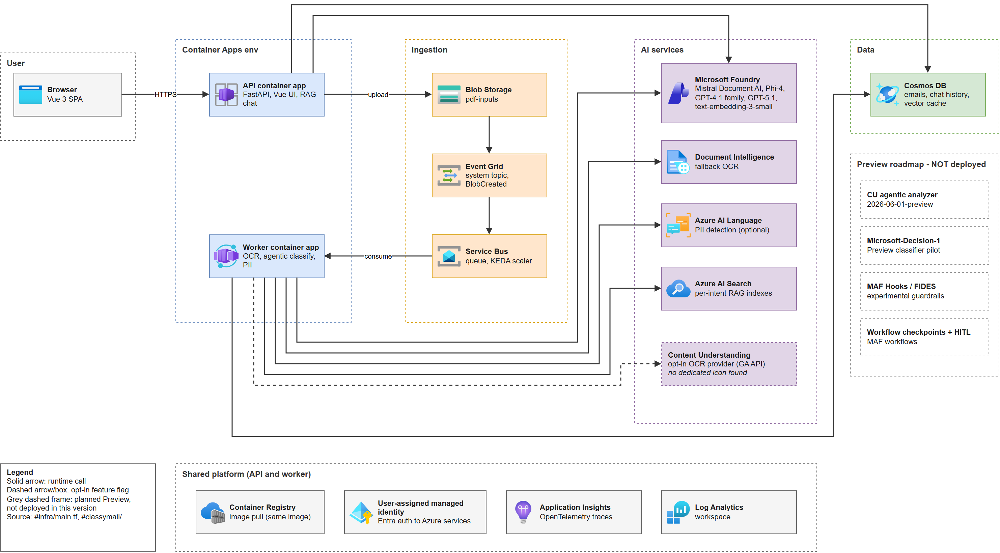
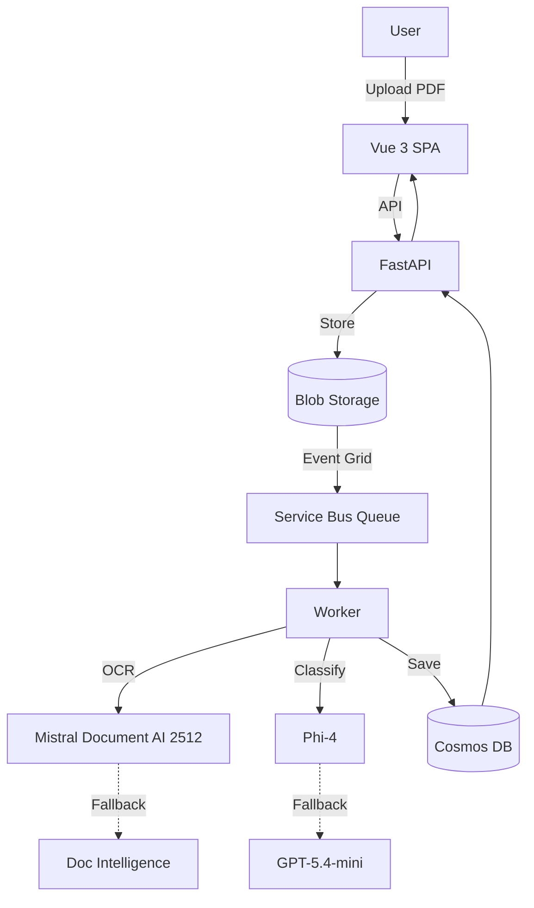

# ClassyMail

**GenAI that knows exactly where every email belongs.**

> **Short link**: [aka.ms/classymail](https://aka.ms/classymail)

ClassyMail is an open-source AI pipeline that automatically classifies emails and PDFs using multi-model inference on Azure. Upload a document, get structured intents with confidence scores — in seconds.

<p align="center">
  <a href="docs/assets/capture_process.png">
    
  </a>
</p>

---

## What It Does

1. **A PDF arrives** (scanned email, letter, invoice) — uploaded through the web dashboard, API, or automatically ingested from Blob Storage via Event Grid.
2. **Mistral Document AI** converts it to Markdown via specialized OCR — preserving layout, headers, and image descriptions. If Mistral is unavailable or rate-limited, the pipeline automatically falls back to **Azure Document Intelligence** via a circuit breaker pattern (a 📄 badge appears in the UI when this happens).
3. **Phi-4** (or a fallback model) reads the Markdown and classifies the email into one or more business intents with confidence scores and justification.
4. **Results appear in the dashboard** where a human reviewer can validate, correct, or reject the classification.
5. **Corrections feed back** into exportable fine-tuning datasets (JSONL) to improve the model over time.

The entire pipeline is event-driven: Blob Storage → Event Grid → Service Bus → Worker — so it scales from 1 email to 10,000+ without code changes.

---

## Latest Updates

| Area | Change | Status |
|------|--------|--------|
| Models | Default aliases: `gpt-6-luna`, `gpt-5.4-mini`, `gpt-6-sol`. Saved settings are preserved; deployment availability and reasoning options must be checked for the selected endpoint (see [Models](docs/MODELS.md)) | Shipped |
| Agentic classification | Human review decided **per label**: any accepted category below the threshold, any failed agent, or a Red Team that did not explicitly validate sets `needs_review` (`agentic.review_reasons`) | Shipped |
| Agentic classification | Specialized agents may only call their own `search_<category>` tool; arguments validated; malformed or out-of-range answers fail that agent only; Red Team outage keeps partial results | Shipped |
| Settings | `POST /api/settings` returns `503` when Cosmos DB persistence fails (the worker reads settings from Cosmos), instead of silently succeeding | Shipped |
| Dependencies | Agent Framework 1.21, OpenAI SDK 2.54 (kept below 3.x), FastAPI 0.141 / Starlette 1.8, Azure SDKs (Identity 1.26, Cosmos 4.17, Blob 12.31, Service Bus 7.15), OpenTelemetry 1.45, pydantic 2.14 stable; pre-releases only where required | Shipped |
| Developer tooling | Dev Container / Codespaces fixed (uv, Node, Docker-in-Docker, sshd); ruff 0.17, pytest 9 | Shipped |
| Documentation | New editable architecture diagram (draw.io + SVG + PNG) with deployed, opt-in and roadmap components clearly separated | Shipped |
| Preview roadmap | Content Understanding agentic analyzer, Microsoft-Decision-1, Agent Framework Hooks / FIDES, workflow checkpoints + human-in-the-loop | **Planned - not deployed** |

---

## Principal Features

### AI Classification Pipeline
- **Hybrid OCR**: Mistral Document AI 2512 as primary, Azure Document Intelligence as automatic fallback with circuit breaker pattern. When Document Intelligence is used, a **📄 amber badge** appears on the email in the dashboard and detail modal so reviewers can see which OCR engine was used.
- **Multi-Model Classification**: Phi-4 (8K context) as primary, GPT-5.4-mini as fallback — switch models from the Settings UI at any time
- **Multi-Intent Detection**: A single email can match multiple categories, each with its own confidence score (0.0–1.0) and text justification

### Configurable Categories & Settings
- **Custom Category Taxonomy**: Define your own business categories with name, slug, description, and exclusion rules — all editable from the Settings UI
- **Model Selection**: Switch classification model (Phi-4, GPT-5.4-mini, GPT-6-luna, Kimi-K2.5, etc.) from Settings — **models are auto-discovered from your AI Foundry project deployments** with a hardcoded fallback list
- **Processing Strategies**: Choose between Standard (fast), Deep Reasoning (Chain-of-Thought), Vision (image-aware), or **Agentic (Multi-Agent)** per processing run
- **Batch Reprocessing**: Reprocess all emails with a different model or strategy for A/B testing

### Agentic Classification (Multi-Agent Pipeline)

- **Orchestrator Inspector**: A fast, cheap model (gpt-6-luna, `reasoning_effort="none"`) scans the document and shortlists up to `max_parallel_agents` (6) candidate categories
- **Parallel Specialized Agents**: One agent per candidate category, each with its own RAG tool calling a dedicated Azure AI Search index for reference examples
- **Tier-aware model selection**: The orchestrator's per-candidate confidence drives the model used by each specialized agent — Tier 1 (`conf ≥ 0.8`, simple) uses cheap models; Tier 2 (`0.5 ≤ conf < 0.8`, ambiguous) uses balanced models; Tier 3 (`conf < 0.5`, critical) uses the most capable models. Same prompt, different muscle.
- **Red Team Quality Gate**: Adversarial reviewer activated when confidence is low or agents disagree — can request **extra agents** which run in a second resilient fan-out
- **Resilient fan-out**: One agent crashing (AI Search 503, OpenAI 429, etc.) no longer fails the whole batch — failed agents return a placeholder so the trace stays continuous and the surviving agents drive the decision (`agentic.parallel.failed_count` OTel attr)
- **Per-label human review**: `needs_review` is raised when *any* accepted category is below the Red Team threshold, an agent failed, or the Red Team did not explicitly validate — a single strong label can no longer hide a weak one (`agentic.review_reasons` OTel attr)
- **Scoped RAG tool**: each specialized agent may only call its own `search_<category>` tool; other tool names are rejected and arguments are validated
- **Per-Category AI Search Indexes**: Add good and bad examples via the Settings UI — agents use them to calibrate confidence



Enable it with **Settings → Processing strategy = agentic**. The values above are the defaults from `#classymail/agents/config.py`; each one is editable in the Settings UI:



UI captures use the local frontend bundle with synthetic fixtures and verified repository model defaults. Scores, timings, and traces are illustrative, not live Azure measurements.

| Setting (key) | Default | Effect in the workflow |
|---------------|---------|------------------------|
| Orchestrator Model (`orchestrator_model`, `orchestrator_routing_mode`) | `gpt-6-luna`, `balanced` | Shortlists candidate categories; `model-router` picks the model per request |
| Max parallel agents (`max_parallel_agents`) | `6` (1-10) | Candidates kept by the orchestrator, and cap on Red Team extra agents |
| Agent Tiers 1/2/3 (`agent_tier1_model` / `agent_tier2_model` / `agent_tier3_model`) | `gpt-6-luna` / `gpt-5.4-mini` / `gpt-6-sol` | Model per candidate confidence band (>= 0.8 / 0.5-0.8 / < 0.5) |
| Red Team (`red_team_model`, `red_team_threshold`, `red_team_conflict_delta`) | `gpt-6-sol`, `0.7`, `0.15` | Gate trigger; the threshold is also the per-label human-review threshold |
| RAG Mode (`retrieval_mode`, `search_top_k`) | `semantic`, `5` | Vector, Hybrid or Semantic retrieval on the per-category index |
| Per-Category Index (`enabled_indexes`) | all enabled | When off for a category, its agent gets no search tool |
| Reasoning effort (`reasoning_effort`) | `none` | Sent to GPT-5.1+ / GPT-6 models; `none` keeps tool calls on Chat Completions fast |



Full documentation: [Agentic classification and AI Search](docs/AGENTIC_CLASSIFICATION.md).

### Dashboard & Export
- **Classification Dashboard**: Card or table view with confidence filters (high/low), status filters (processed/review/error), PII indicators, and real-time search
- **Email Detail Modal**: Side-by-side PDF preview + classified intents with confidence bars, justification text, and one-click correction
- **CSV Export**: Download classification results as semicolon-delimited CSV with intents, confidence scores, model used, processing time, and PII metadata
- **Batch Actions**: Mark emails as reviewed, reprocess selections, or export subsets

### Human Review & Fine-Tuning Loop
- **Correction Workflow**: Reviewers override wrong classifications with a reason — corrections are stored as golden labels with full audit trail
- **AI Feedback**: Each correction generates an LLM feedback message explaining what the model missed, used for prompt improvement
- **Auto-Feed to AI Search**: When a user corrects a classification, the email is automatically pushed as a negative example to the old (wrong) category and a positive example to the new (correct) category in the per-category AI Search indexes
- **One-Click Reinforcement**: Click "Reinforce" on any correctly classified email to push it as a `human_reinforced` positive example into its category's AI Search index — teaches the agentic pipeline "this is right"
- **Fine-Tuning Export**: Export reviewed JSONL examples with deterministic train/test splitting and optional anonymization. Inspect all fields and verify the training service's accepted schema and model eligibility before submission (see [data and privacy](docs/PII_ANONYMIZATION_AND_USER_CORRECTIONS.md)).
- **Human Reinforcement**: Corrections and reinforcement update retrieval examples; they do not automatically retrain models or weight fine-tuning samples.
- **Category AI Assessment**: GPT-6-luna analyzes your category definitions and suggests improvements based on classification patterns
- **Per-Category AI Search Indexes**: Each category gets its own Azure AI Search index with positive and negative reference examples — agents use RAG to calibrate confidence (see [AI_SEARCH_INDEXES](docs/AGENTIC_CLASSIFICATION.md))

### RAG Chatbot
- **Chat with your emails**: GPT-6-sol reasoning model with vector search over all processed documents, orchestrated by **Microsoft Agent Framework 1.21** (`agent-framework-core>=1.21` + `agent-framework-openai>=1.16`) — per-locale `Agent` cache, `ContextVar`-scoped dependency injection, and full chat history replay via `list[Message]`
- **Agent-driven suggestions**: The LLM agent generates contextual follow-up action pills after each response — no hardcoded logic
- **Ask AI button**: Click ✨ on any email card or table row to open the chatbot pre-filled with that email’s context
- **12 agent tools**: Semantic search (with date filtering), keyword search (case-insensitive), reclassification handoff, sequential review, stats, error analysis, category explanation
- **Semantic vector search**: Emails are embedded with `text-embedding-3-small` (1536-dim) during processing. The chatbot uses Cosmos DB `VectorDistance()` for concept-level matching
- **Semantic cache**: Repeated similar questions are served from a vector cache (>99% similarity), saving tokens

### Security & Operations
- **Managed identity**: the apps reach Storage, Cosmos DB, Foundry, AI Search and Language with a user-assigned managed identity (no API keys in app config). Exception: the KEDA Service Bus scaler still uses a connection string stored as a Container App secret (`#infra/main.tf`).
- **PII Detection**: LLM-based, Azure AI Language, or Hybrid mode. Detection does not erase stored data or establish GDPR compliance.
- **Dynamic Cost Tracking**: Real token usage per email across 12+ model pricing tiers, with links to [Microsoft Azure OpenAI Pricing](https://azure.microsoft.com/en-us/pricing/details/cognitive-services/openai-service/)
- **Danger Zone**: Admin operations organized by severity — Maintenance (diagnostics), Bulk Operations (reprocess all, rebuild vector index, DLQ), and Destructive (atomic reset)
- **Rebuild Vector Index**: One-click re-embedding of all emails for semantic search repair
- **i18n**: 5 languages (EN, FR, DE, ES, IT) with 500+ translation keys
- **Build metadata**: Commit SHA and build timestamp baked into Docker image, visible in the Info modal

---

## Architecture

[](docs/assets/classymail-architecture.svg)

Editable source: [docs/assets/classymail-architecture.drawio](docs/assets/classymail-architecture.drawio) (open in draw.io; SVG and PNG are exported from it). The diagram reflects what `#infra/main.tf` deploys and what `#classymail/` calls:

| Status | Components |
|--------|------------|
| **Deployed** | API and worker Container Apps (same image), Blob Storage, Event Grid, Service Bus (KEDA scaling), Microsoft Foundry models, Document Intelligence, Azure AI Language, Azure AI Search, Cosmos DB, Container Registry, managed identity, Application Insights, Log Analytics |
| **Opt-in (feature flag, off by default)** | Content Understanding OCR provider (`OCR_PROVIDER=content_understanding`, GA API `2025-11-01`), chat streaming (`CHAT_STREAMING`) |
| **Preview roadmap - not deployed, not in the code yet** | Content Understanding agentic analyzer (`2026-06-01-preview`), Microsoft-Decision-1 classifier pilot, Agent Framework Hooks / FIDES guardrails, workflow checkpoints with human-in-the-loop |

Simplified processing flow:



---

## Quick Start

```bash
# Prerequisites: Python 3.12, Node.js 22+, Azure CLI

# Generate secrets from Azure
./scripts/write_secrets_env.ps1 -ResourceGroup "<prefix>-rg" -Force

# Backend
uv sync && uv run uvicorn main:app --reload

# Frontend (separate terminal)
cd frontend && npm install && npm run dev

# Health check
curl http://localhost:8000/healthz
```

See [docs/LOCAL_DEVELOPMENT.md](docs/LOCAL_DEVELOPMENT.md) for full setup or [docs/DEPLOY_FROM_SCRATCH.md](docs/DEPLOY_FROM_SCRATCH.md) for a fresh Azure deployment.

---

## Tech Stack

- **Backend**: FastAPI (Python 3.12) + uv
- **Frontend**: Vue 3 + Vite + TailwindCSS + vue-i18n
- **Infra**: Terraform (azurerm v4 + azapi)
- **AI**: Microsoft AI Foundry (Mistral, Phi-4, GPT-6-luna, GPT-5.4-mini, GPT-6-sol) + Microsoft Agent Framework 1.21
- **Storage**: Cosmos DB (serverless + vector search + composite indexes), Blob Storage
- **Auth**: Managed Identity (KEDA scaler excepted, see Security & Operations)
- **CI/CD**: GitHub Actions with OIDC

---

## AI Models

### Required Models (core pipeline)

| Model | Deployment Name | Purpose | SKU |
|-------|----------------|---------|-----|
| **Phi-4** | `phi-4` | Primary classification | GlobalStandard |
| **Mistral Document AI 2512** | `mistral-document-ai-2512` | OCR / PDF extraction | GlobalStandard |

### Optional Models (enhanced features)

| Model | Deployment Name | Purpose | Required for |
|-------|----------------|---------|-------------|
| GPT-5.4-mini (2026-03-17, retires 2027-09-21) | `gpt-5.4-mini` | Fallback classifier, PII detection/anonymization, vision, agentic tier 2 | Large emails (>8K tokens) |
| GPT-6-luna (2026-09-22, retires 2028-03-11) | `gpt-6-luna` | Category assessment, agentic orchestrator and tier 1 | Assessment / agentic |
| GPT-6-sol (2026-09-22, retires 2028-03-11) | `gpt-6-sol` | RAG chatbot, synthetic data, agentic tier 3 and Red Team | Chat / agentic |
| text-embedding-3-small | `text-embedding-3-small` | Vector embeddings for RAG chatbot | Chat / semantic search |

> **Not all models are required.** The pipeline works with just Phi-4 + Mistral OCR. Optional models enable fallback classification and RAG chat. Deploy only what you need.

#### Migration from GPT-4.1

The GPT-4.1 family (`gpt-4.1`, `gpt-4.1-mini`, `gpt-4.1-nano`, 2025-04-14) is **Deprecated**: only subscriptions that already deployed it can create it, and it stops answering on **2027-04-14**. `gpt-5.1` retires 2027-05-15. Checked with the Azure Models API (swedencentral, francecentral) on 2026-10-14.

| Previous default | New default | Why this one |
|------------------|-------------|--------------|
| `gpt-4.1-nano` | `gpt-6-luna` | Same input price ($0.10 / 1M), longest support (2028-03-11) |
| `gpt-4.1-mini` | `gpt-5.4-mini` | Mini-sized model, 400K context, GA until 2027-09-21 |
| `gpt-4.1`, `gpt-5.1` | `gpt-6-sol` | Same input price as gpt-4.1 ($2 / 1M), GA until 2028-03-11 |

GPT-6 and GPT-5.4 are reasoning models: `#classymail/services/openai_client_factory.py` sends `reasoning_effort="none"` and `max_completion_tokens` on the classification calls so the small output budgets are not consumed by reasoning.

**Existing demo, nothing breaks:** saved settings are not rewritten, so an environment whose settings name `gpt-4.1-*` keeps using those deployments until 2027-04-14. If Terraform manages the models or the app settings, keep the current deployments with:

```hcl
deploy_legacy_models = true            # keeps gpt-4.1, gpt-4.1-mini, gpt-4.1-nano, gpt-5.1
chat_deployment      = "gpt-5.1"
fallback_deployment  = "gpt-4.1-mini"
```

Then deploy `gpt-6-luna`, `gpt-5.4-mini` and `gpt-6-sol`, select them in **Settings**, and remove the three overrides before 2027-04-14.

> **Note on OCR 4:** the `mistral-document-ai-2512` deployment *is* Mistral OCR 4 — the pipeline already runs the latest Mistral OCR. Pin a specific dated version via the `MISTRAL_DEPLOYMENT` env var if needed (see `#classymail/core/config.py`).

#### Experimental: Azure AI Content Understanding OCR (opt-in, default-off)

An optional third OCR provider — [Azure AI Content Understanding](https://learn.microsoft.com/azure/ai-services/content-understanding/) — is available behind a feature flag as a PoC. It is **disabled by default**; the standard Mistral → Document Intelligence flow is unchanged unless you opt in.

To try it, set `OCR_PROVIDER=content_understanding` and configure the endpoint:

```bash
OCR_PROVIDER=content_understanding            # default "mistral" keeps current behavior
CONTENT_UNDERSTANDING_ENDPOINT=https://<your-foundry-resource>.cognitiveservices.azure.com/
CONTENT_UNDERSTANDING_ANALYZER_ID=prebuilt-documentSearch   # RAG-optimized markdown extraction
CONTENT_UNDERSTANDING_API_VERSION=2025-11-01
# CONTENT_UNDERSTANDING_KEY=<key>             # optional; Managed Identity preferred
```

When enabled, Content Understanding becomes the primary OCR pass (async analyze + poll → Markdown) and **Azure Document Intelligence remains the universal fallback**. Implementation: `#classymail/services/llm_pipeline.py` (`ocr_with_content_understanding`), wired in `#classymail/services/pipeline.py`.

> **Pricing in the Settings UI is hardcoded** (estimated Azure rates as of 2025-2026). Actual costs depend on your region and Azure agreement. The backend cost calculator uses the same hardcoded rates. See `classymail/services/costing.py` and `frontend/src/views/SettingsView.vue` for the pricing tables.

### RAG Chatbot (Vector Search)

The chatbot uses **semantic vector search** over all processed emails, powered by **Microsoft Agent Framework** 1.21:

1. **During processing**: Each email’s OCR markdown is embedded using `text-embedding-3-small` (1536 dimensions) and stored in Cosmos DB with `type: "email"`. Chunks are also embedded separately with `type: "chunk"`
2. **During chat**: User queries are embedded, then Cosmos DB `VectorDistance()` finds the most semantically similar emails — with optional date filtering (`days` parameter for “last week” queries). If the container's vector index rejects `ORDER BY VectorDistance` (a known Cosmos quantized-index drift), the repository automatically falls back to a brute-force scan (compute distances in `SELECT`, sort client-side) so search keeps working
3. **Chat model** (GPT-6-sol reasoning model) generates answers grounded in retrieved context, with source citations. The chat agent targets the Azure OpenAI **v1 surface**, which requires `CHAT_API_VERSION=preview` (see [ACA_ENVIRONMENT_VARIABLES](docs/DEPLOY_FROM_SCRATCH.md))
4. **Semantic cache**: Similar questions (>99% cosine similarity) return cached responses instantly
5. **Agent-driven actions**: The LLM appends contextual follow-up suggestions (hidden `<!-- ACTIONS -->` block) that appear as clickable pills in the UI

> **Rebuild embeddings**: If emails were processed before the embedding model was deployed, use **Settings → Danger Zone → Rebuild Vector Index** to regenerate all vectors.

> **Opt-in streaming** (`CHAT_STREAMING`, default `false`): when enabled, chat answers stream token-by-token into the UI via Server-Sent Events (`POST /api/chat/stream`) for lower perceived latency. When off, the UI uses the single-shot `POST /api/chat` JSON response (unchanged default behavior). The flag is exposed through `/api/admin/ui-config` so the frontend only streams when it is on; both endpoints share the same grounding, history, and semantic cache. See [ACA_ENVIRONMENT_VARIABLES](docs/DEPLOY_FROM_SCRATCH.md).

> The chat button is **automatically hidden** in the UI if `CHAT_DEPLOYMENT` or `EMBEDDING_DEPLOYMENT` are not configured. Deploy the optional models to enable it.
> Category AI Assessment is also **automatically disabled** if the assessment model isn't deployed in your AI Foundry project.

> **Opt-in Agent Framework tuning (default-off):** Two flags let you tune the chat agent without changing default behavior. Set `CHAT_REASONING_EFFORT=minimal|low|medium|high` to forward a reasoning effort to the model (`OpenAIChatOptions.reasoning`), and set `CHAT_HISTORY_COMPACTION=true` to replace the fixed last-10-turns window with token-aware compaction (`ContextWindowCompactionStrategy` + the built-in `CharacterEstimatorTokenizer`, budgets via `CHAT_COMPACTION_MAX_TOKENS` / `CHAT_COMPACTION_MAX_OUTPUT_TOKENS`). Both are unset/off by default — see [ACA_ENVIRONMENT_VARIABLES](docs/DEPLOY_FROM_SCRATCH.md).

---

## Documentation

| Guide | Contents |
| --- | --- |
| [Local development](docs/LOCAL_DEVELOPMENT.md) | Setup, tests and CLI helpers |
| [Deployment](docs/DEPLOY_FROM_SCRATCH.md) | Terraform, configuration, RBAC and CI/CD |
| [Architecture](docs/ARCHITECTURE.md) | Runtime flow, ownership and diagrams |
| [Agentic classification](docs/AGENTIC_CLASSIFICATION.md) | Multi-agent workflow and AI Search examples |
| [Models](docs/MODELS.md) | Deployment aliases, OCR and chat options |
| [Integration](docs/INTEGRATION.md) | UI, categories, API and CSV exports |
| [Data and privacy](docs/PII_ANONYMIZATION_AND_USER_CORRECTIONS.md) | Corrections, JSONL exports and anonymization limits |
| [Costs](docs/COSTS_LOGIC.md) | Usage-based estimates and their limitations |
| [Troubleshooting](docs/TROUBLESHOOTING_MAP.md) | Runtime failures and state drift |

Full index: [docs/INDEX.md](docs/INDEX.md)

## License

MIT — see [LICENSE](LICENSE) for details.
